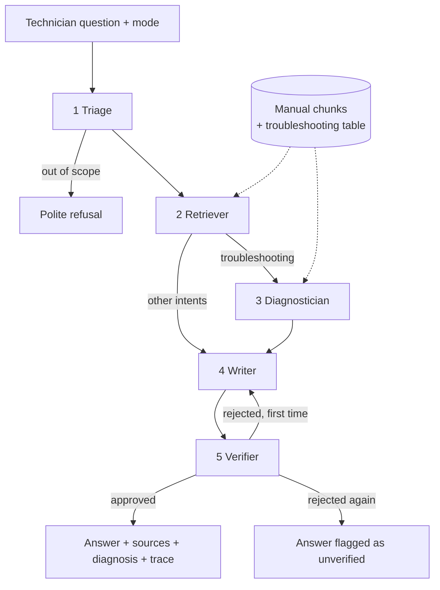
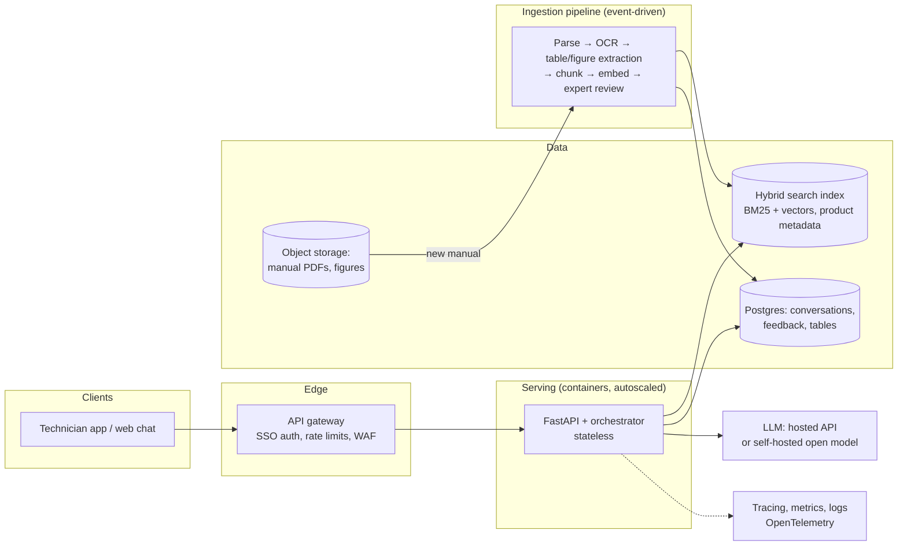

# Architecture and deployment

## 1. Problem

Field technicians troubleshoot Fluidra equipment without knowing every product in depth.
They need short, correct, **sourced** answers from the official manuals, from a phone next
to the equipment. A wrong answer can damage equipment or injure someone, so grounding and
safety are more important than fluency.

## 2. Agent design

The work is split into five agents, each with **one responsibility and typed inputs and
outputs** (Pydantic models). A plain-Python orchestrator runs them in a fixed order.

The user picks one of **six modes** for every question; there is no default and no fallback
between them:

- **`qwen`, `llama`, `gemma`, `deepseek`**: free local LLMs run with **Ollama** (no paid
  services, as the brief requires). **Every agent makes its decisions with that model.** If a
  call fails, the question fails with an error, so the user knows which mode produced an answer.
- **`auto`**: the LLM (`qwen`, `AUTO_MODEL` in config.py) only for **triage and writer**, the
  two steps that need language understanding. **Retriever, diagnostician and verifier** use
  the offline implementations (§ 2.1.1).
- **`offline`**: every agent uses word matching and fixed rules, with no LLM. Instant and
  deterministic, useful as a baseline to compare the models against.

| Agent | Responsibility | LLM modes | `offline` mode (also used by `auto` for 2, 3 and 5) |
|---|---|---|---|
| **1 Triage** | Is the question in scope? What intent (troubleshooting, installation, maintenance…)? Which language, product and symptoms? | JSON schema output: scope, intent, language, product, symptom ids from the manual's list, and the question rewritten as an English search query | Keyword lists; symptoms from the `keywords` in `data/curated/` |
| **2 Retriever** | Find the manual passages that answer the question | The LLM reads a numbered list of all passages (page, section, first 300 characters) and returns the relevant ones, most useful first | BM25 with the question and the symptom labels |
| **3 Diagnostician** | Troubleshooting only: rank the possible causes and fixes | The LLM picks rows of the troubleshooting table and gives each a likelihood, using the details in the question | Rows that share the matched symptoms; those that explain more symptoms rank first |
| **4 Writer** | Write the answer in the technician's language, with a `[p. N]` citation on every statement | The LLM, given the ranked causes and the excerpts; the prompt tells it when to add the safety warning | English templates; safety warning added when electrical words appear |
| **5 Verifier** | Last check before the answer is returned | The LLM answers yes/no checks (citations from the evidence, every statement supported, safety warning needed and present) and lists the issues | Rules: citations present, cited pages in the evidence, safety warning present |

A rejected answer goes back to the writer with the issues for one rewrite, when the writer is
an LLM (LLM and `auto` modes; offline templates would give the same text again).

### 2.1 Why these boundaries

- **Triage first.** Routing happens before any other work. Out-of-scope questions stop after one step, and only troubleshooting questions go to the diagnostician.
- **Retrieval is separate from writing.** The writer never searches; it only uses the evidence it is given. If nothing is found, it says so instead of guessing.
- **Diagnosis picks from the manual's table, never invents.** The LLM chooses and ranks rows by number; the cause and solution text is copied from the table in code. A row number that doesn't exist is dropped.
- **Writer and verifier are separate.** The verifier is an independent step with its own prompt, and its rejection gives the writer concrete feedback for a rewrite.

#### 2.1.1 Why `auto` splits the agents this way

- **Triage needs the LLM.** Paraphrases ("water barely comes out") and other languages are
  where keyword lists fail. The LLM maps them to the manual's symptom labels and an English
  search query, which is exactly what the offline retriever and diagnostician work with.
- **Retrieval is a search problem.** BM25 over 30 passages finds them in milliseconds, and the
  LLM retriever only sees 300-character previews anyway.
- **Diagnosis is a lookup.** Once triage has named the symptoms, the table rows follow from
  them; the LLM ranking mostly reorders the same rows.
- **The writer needs the LLM** to answer in the technician's language, in natural sentences.
- **The verifier's citation and safety checks are rules**, so a small model can't approve an
  answer with a made-up page or a missing disconnect-power warning. The safety words in
  `common.py` cover the languages the writer answers in.
- **Trade-off:** `auto` does not check that each statement is supported by the evidence (the
  LLM verifier's `supported` check), only that the cited pages are real. An answer that says
  "not in the manual" without citing a page is rejected and flagged as unverified.

### 2.2 Key design decisions

| Decision | Rationale | Trade-off |
|---|---|---|
| **Free local LLMs (Ollama), four to choose from** | No paid services; data stays on the machine. 3–4B models (or a mixture of experts like DeepSeek-V2 16B, which uses about 2.4B per token) run on a laptop CPU, and comparing them is one flag. | Slow on CPU and less reliable than a large model (§ 2.3). |
| **Every agent uses the LLM in LLM modes** | The agents judge with language understanding instead of word lists, so paraphrases and other languages work in every step. | Five calls per question (seven with a rewrite): minutes on a CPU. |
| **No fallback between modes** | An answer always comes from the mode the user chose, so comparisons between models are honest and failures are visible. | Without Ollama, only `offline` mode works. |
| **The LLM picks by number, code copies the text** | Symptoms, passages and table rows are chosen by id; unknown ids are dropped. The model can't put words in the manual's mouth. | — |
| **Structured output** | Ollama constrains every decision to the Pydantic model's JSON schema, so the orchestrator gets validated data, not free text. | — |
| **Code-controlled workflow, not an autonomous agent loop** | The routes are known in advance. A fixed flow is predictable, testable and easier to certify for a safety-relevant use case. | Less flexible for multi-step questions. |
| **Hand-curated troubleshooting table** | The PDF table extracts as unaligned text and loses which cause belongs to which symptom. It is the most valuable content for this use case, so it is transcribed from the rendered page (`data/curated/`). Its keywords are used only in offline mode. | Manual step per product. In production, a vision model extracts it and an expert approves it (§ 3.2). |
| **Page-level chunks with carried-over section titles** | Every chunk maps to exactly one page, so `[p. N]` citations are exact and verifiable. | Some passages are split at page breaks. |
| **The whole passage list in the retriever prompt** | One manual is 30 passages (about 3k tokens of previews), so the LLM can see them all. | Doesn't scale to many manuals; production needs a search step first (§ 3.2). |

### 2.3 Limitations of the prototype

- **Small models on CPU.** On a laptop without a GPU, an LLM question takes about 1–4 minutes. The first question is the slowest: Ollama loads the model and processes the passage list (later questions reuse it from Ollama's cache). Observed quality issues:
  - It sometimes picks the wrong symptom or cause (e.g. "the pump won't start" diagnosed as the thermal protection tripping).
  - It sometimes adds generic steps that aren't in the manual, or translates badly.
- **Safety now depends on the model.** In LLM modes, the safety warning is added by the writer and checked by the verifier, both LLM judgements. A small model can miss it. `auto` and `offline` modes check it with rules.
- **A small model checking another small model.** The LLM verifier tends to approve; using a different model for the verifier than for the writer would make it more independent.
- One manual, English section only (pages 5–14). The other languages duplicate the content, and the non-Latin pages extract as garbage without OCR.
- Figures (wiring diagrams, installation zones, priming) are not indexed.
- No conversation memory. Each question stands alone.
- No authentication, rate limiting or persistence.

### 2.4 Improvements

- **A larger model gives better results.** The four models are swapped with `--mode`; a new one is one line in `MODELS` in config.py:
  - A bigger free local model (e.g. `qwen2.5:7b` or `llama3.1:8b` on Ollama) follows instructions, translates and stays on the evidence much better. It needs a GPU to be fast.
  - A hosted model (e.g. Claude, through its API or the cloud provider Fluidra already uses) gives the best quality and speed, paid per token (§ 3.8).
  - The choice should be made with the evaluation set (§ 3.5), with `offline` mode as the baseline and `auto` as the cheap middle option.
- **A different model per agent**, e.g. a small fast one for triage and a stronger one for writing and verifying. `auto` is a first step: the LLM only where it is needed.
- **Fewer calls**: triage and diagnosis could share one call, and the verifier could check only answers that involve electrical work or many claims.
- **Stream the writer's answer** so the technician sees text immediately instead of waiting for the whole reply.

---

## 3. Deploying to production

### 3.1 Target architecture

The design is cloud-agnostic. The components map to managed services on any provider:

| Component | Azure | AWS | GCP |
|---|---|---|---|
| Containers | Container Apps / AKS | ECS Fargate / EKS | Cloud Run / GKE |
| Search index | Azure AI Search | OpenSearch | Vertex AI Search / AlloyDB pgvector |
| Relational store | Azure Database for PostgreSQL | RDS / Aurora | Cloud SQL |
| Object storage + events | Blob Storage + Event Grid | S3 + EventBridge | GCS + Eventarc |
| Hosted LLM | Microsoft Foundry | Amazon Bedrock | Vertex AI |
| Secrets | Key Vault | Secrets Manager | Secret Manager |

The best choice is whatever cloud Fluidra already runs on, which keeps billing, IAM and data
residency (EU regions) within existing contracts. A self-hosted open model (Llama or Qwen,
served with Ollama or vLLM on GPU nodes) is the alternative if cost per call or data control
matter more than answer quality.

### 3.2 Ingestion pipeline (the biggest gap between prototype and production)

Triggered when a manual is uploaded or revised:

1. **Register** the document with metadata: product, family, SKU range, revision, languages and page ranges. The prototype's `manifest.json` becomes a table fed from the product information system.
2. **Parse** with a layout-aware parser. Detect each page's language automatically instead of declaring ranges, and OCR the non-Latin pages.
3. **Extract tables and figures** with a vision-capable model: troubleshooting tables become structured rows, and wiring and installation diagrams get text descriptions so they are retrievable. **A product expert approves the extracted tables** before they go live, because they drive diagnoses.
4. **Chunk and index** with hybrid search (BM25 + multilingual embeddings), keeping page, section, product and revision metadata. Questions are then filtered by product before ranking, which matters once there are hundreds of similar pump manuals.
5. **Version** the index. When a new manual revision is published, swap aliases atomically and keep the old revision for answers already given.

### 3.3 Serving

- The API is **stateless** and horizontally autoscaled. Conversation state lives in Postgres, keyed by session.
- Use async calls and run independent steps concurrently where the flow allows.
- **Stream** the writer's output to the client to reduce perceived latency. Verification runs on the full draft, so either show "verifying…" or stream and retract on failure.
- **Prompt caching** for the stable system prompts and the troubleshooting tables, plus a response cache for frequent identical questions (scoped per manual revision).
- Timeouts, retries and backoff, plus circuit breakers.
- **When the LLM is unavailable**: the prototype shows the error (in the web app chat or the CLI) rather than silently switching mode. In production, the app could offer the technician the `offline` mode explicitly, with the answer marked as such.

### 3.4 Conversation and product context

- Multi-turn sessions: triage receives the previous turns so it can resolve "it still doesn't work".
- Product disambiguation: if the product is unknown, ask the technician (or let them scan the rating-plate QR or serial) instead of searching every manual.

### 3.5 Quality: evaluation as a release gate

- **Golden set**: about 150–300 real technician questions with expected pages and key facts, built with Fluidra's technical service team and covering every intent, the main languages and out-of-scope cases.
- **Metrics**:
  - Retrieval: recall@k of the expected pages.
  - Faithfulness: an LLM judge checks that every claim is supported.
  - Answer correctness against the key facts.
  - Safety-warning presence.
  - Refusal correctness.
  - Latency and cost per answer.
- **CI gate**: every change to prompts, models, chunking or retrieval reruns the eval. Merges are blocked on regressions. This is also how the model is chosen (local vs. hosted, small vs. large) per agent.
- **Online**: thumbs up/down plus a "this was wrong" reason in the app, sampled human review of flagged and unverified answers, and a weekly review with the technical service team. Confirmed failures go into the golden set.

### 3.6 Observability

- An OpenTelemetry trace per question, with one span per agent recording latency, model, tokens, mode and verifier verdicts. The prototype already returns a per-agent trace in each response.
- Dashboards: p50/p95 latency, cost per answer, verification-failure rate, error rate per mode, out-of-scope rate, "not in manual" rate. A rising "not in manual" rate shows which documentation is missing.
- Alerts on error rate, latency, cost spikes and a drop in verification pass rate.

### 3.7 Security and compliance

- **Authentication** via company SSO / OIDC for technicians and partners, with role-based access for internal documentation.
- **Gateway**: rate limiting per user, input size limits, WAF.
- **Prompt injection**: outputs are schema-constrained or post-checked in code, and the agents have no tools with side effects. If ingested documents ever come from outside Fluidra, they must be sanitised at ingestion.
- **Privacy**: detect and redact personal data (customer names, addresses in free text) before logging. Set log retention and keep data in the EU region to meet GDPR. Check the LLM provider's data-retention terms, or use a self-hosted model.
- **Liability**: answers carry sources and the safety warnings; unverified answers are marked; electrical work is always deferred to qualified personnel as the manual requires.

### 3.8 Cost and latency (rough order of magnitude)

- **Hosted model**: about 2–3 calls per question with a few thousand tokens each, which is cents per question on a top-tier model and much less on a smaller one.
- **Self-hosted model**: no cost per call, but GPU capacity sized for peak traffic. On GPU, a 7–8B model answers in a few seconds instead of the 10–60 s seen on the prototype's laptop CPU.
- **Levers**, each validated against the eval set:
  - Prompt caching.
  - A smaller model for triage.
  - A response cache for frequent questions.
  - Streaming, with "searching… diagnosing… writing…" progress in the app.

### 3.9 Delivery

- **Infrastructure as code** (Terraform or Bicep). Dev, staging and production environments, each with its own index and keys.
- **CI**: lint, unit tests (they use a fake LLM and need no model), then the eval gate, a container build and an image scan.
- **CD**: deploy to staging, run a smoke test against the golden subset, then a canary to production with automatic rollback on SLO breach.
- **Rollout**:
  1. Internal pilot with the technical service team (shadow mode: they compare answers with their own).
  2. A small group of field technicians on 2–3 product families.
  3. Expand product coverage as the ingestion pipeline reaches each family.
