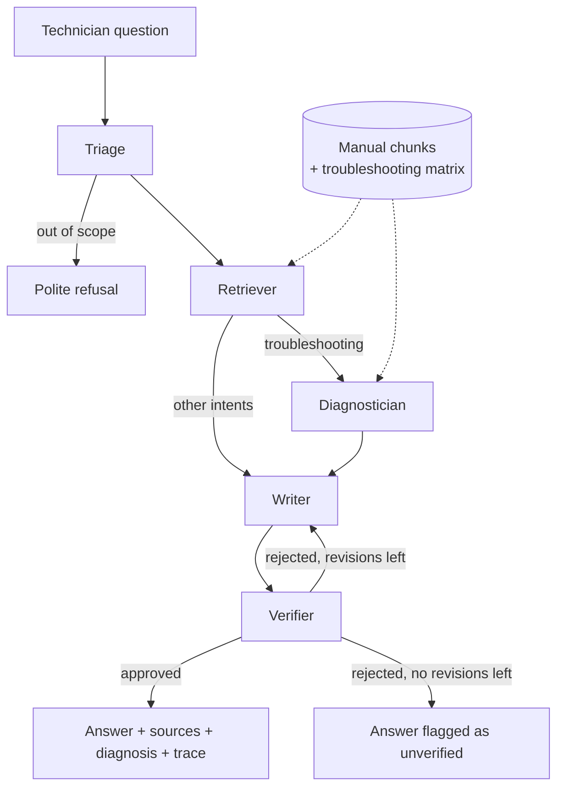
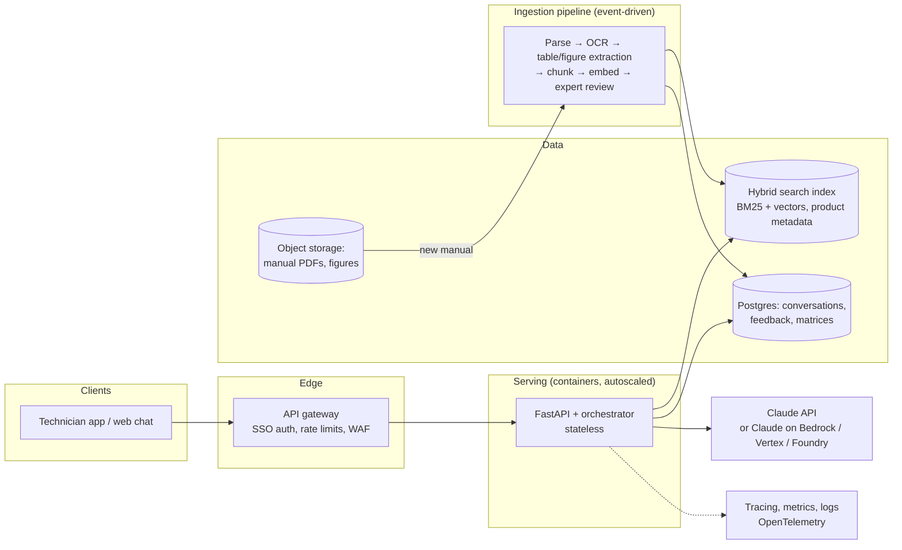

# Architecture and deployment

## 1. Problem

Field technicians troubleshoot Fluidra equipment without knowing every product in depth.
They need short, correct, **sourced** answers from the official manuals, in their own
language, from a phone next to the equipment. A wrong answer can damage equipment or
injure someone, so grounding and safety are more important than fluency.

## 2. Agent design

The work is split into five agents. Each has **one responsibility, one typed output
schema and one prompt**. A plain-Python orchestrator connects them.

| Agent | Responsibility | Output | Effort |
|---|---|---|---|
| **Triage** | Is it in scope? What intent (troubleshooting, installation, maintenance…)? Which product? Which language? Rewrite it as English search queries. | `TriageOutput` | low |
| **Retriever** | BM25 search over the manuals, then the LLM selects the passages that actually answer the question, or reports that nothing does. | `EvidenceSelectionOutput` → `RetrievalResult` | low |
| **Diagnostician** | Troubleshooting only. Map the symptoms to ranked causes and fixes using the product's troubleshooting matrix, and pick the safest first check. | `DiagnosisOutput` | medium |
| **Writer** | Write the answer in the technician's language, using only the evidence, with a `[p. N]` citation on each statement. On a revision, fix the verifier's issues. | `DraftAnswerOutput` | medium |
| **Verifier** | Deterministic policy checks (citations, allowed pages, disconnect-power warning) plus an LLM grounding review. A rejection loops back to the writer. | `VerdictOutput` | medium |

### Why these boundaries

- **Triage first.** Routing happens before any expensive work. Out-of-scope questions cost one cheap call. Translating to English queries lets one English index serve technicians in every language.
- **Retrieval is separate from writing.** The writer never searches, so it can't wander outside the evidence. The retriever's "nothing relevant" outcome turns into an honest "the manual doesn't cover this" instead of a plausible guess.
- **Diagnosis is its own agent.** Troubleshooting is the core use case and has a different shape: rank causes, choose the order of checks. It reasons over a **structured matrix** rather than prose, and it is skipped for other intents.
- **Writer and verifier are separate.** A model checking its own output in the same call tends to approve it. A separate reviewer with a strict prompt, plus deterministic rules, catches unsupported values and missing safety steps. The loop is bounded (`MAX_REVISIONS=1`). If the last draft still fails, it is delivered with a visible "not verified" warning rather than hidden.

### Key design decisions

| Decision | Rationale | Trade-off |
|---|---|---|
| **Code-controlled workflow, not an autonomous agent loop** | The routes are known in advance. A fixed graph is predictable, testable and cheaper, and easier to certify for a safety-relevant use case. | Less flexible for multi-hop questions. Adding a "planner" agent would be the next step if evals show the need. |
| **Structured outputs for every agent** (`messages.parse` + Pydantic) | Agents exchange validated objects, not free text. Malformed output fails loudly at the boundary. | Schemas must stay within the structured-output subset (no numeric constraints). |
| **Deterministic guardrails in the verifier** | Safety rules (disconnect power before electrical work, cite real pages) must not depend on a model's judgement. | Keyword rules over-trigger a little, which is acceptable for a safety warning. |
| **Hand-curated troubleshooting matrix** | The PDF table extracts as unaligned text and loses which cause belongs to which symptom. The matrix is the most valuable content for this use case, so it is transcribed from the rendered page (`data/curated/`). | Manual curation step per product. In production, a vision model extracts it and an expert approves it (§ 3.2). |
| **Page-level chunks with carried-over section titles** | Every chunk maps to exactly one page, so `[p. N]` citations are exact and verifiable. | Some passages are split at page breaks. |
| **BM25 retrieval** | One small manual, no external service, deterministic tests. | Weak on paraphrases. The LLM's query rewriting compensates, and production uses hybrid search (§ 3.3). |
| **Offline mode + one LLM interface** | Every agent has a deterministic fallback. The app runs and tests pass without an API key, and if an LLM call fails, the pipeline degrades instead of crashing. The trace shows which agents fell back. | Offline answers are template-based and English-only. |
| **Per-agent effort** | Classification and passage selection don't need deep reasoning. Diagnosis, writing and verification get more. | Effort levels should be tuned against an eval set (§ 3.5). |
| **Claude server-side fallbacks** | If a safety classifier declines a legitimate technical question, the API retries on a fallback model instead of failing. | Small extra latency on those rare requests. |
| **Prompt-injection hygiene** | User text and passages are wrapped in tags and declared as data. Output is schema-constrained. Product names from the model are checked against the catalog. | Not a complete defence on its own (see § 3.7). |

### Prototype limitations (by design, for the scope of the exercise)

- One manual, English section only (pages 5–14). The other languages duplicate the content, and the non-Latin pages extract as garbage without OCR.
- Figures (wiring diagrams, installation zones, priming) are not indexed.
- No conversation memory. Each question stands alone.
- No authentication, rate limiting or persistence.

---

## 3. Deploying to production

### 3.1 Target architecture

The design is cloud-agnostic. The components map to managed services on any provider:

| Component | Azure | AWS | GCP |
|---|---|---|---|
| Containers | Container Apps / AKS | ECS Fargate / EKS | Cloud Run / GKE |
| Search index | Azure AI Search | OpenSearch | Vertex AI Search / AlloyDB pgvector |
| Relational store | Azure Database for PostgreSQL | RDS / Aurora | Cloud SQL |
| Object storage + events | Blob Storage + Event Grid | S3 + EventBridge | GCS + Eventarc |
| LLM | Claude via Microsoft Foundry or the Claude API | Claude via Amazon Bedrock or the Claude API | Claude via Vertex AI or the Claude API |
| Secrets | Key Vault | Secrets Manager | Secret Manager |

The best choice is whatever cloud Fluidra already runs on. Calling Claude through that
cloud keeps billing, IAM and data residency (EU regions) within existing contracts. The
code only needs a different client class.

### 3.2 Ingestion pipeline (the biggest gap between prototype and production)

Triggered when a manual is uploaded or revised:

1. **Register** the document with metadata: product, family, SKU range, revision, languages and page ranges. The prototype's `manifest.json` becomes a table fed from the product information system.
2. **Parse** with a layout-aware parser. Detect each page's language automatically instead of declaring ranges, and OCR the non-Latin pages.
3. **Extract tables and figures** with a vision-capable model: troubleshooting matrices become structured rows, and wiring and installation diagrams get text descriptions so they are retrievable. **A product expert approves the extracted tables** before they go live, because they drive diagnoses.
4. **Chunk and index** with hybrid search (BM25 + multilingual embeddings), keeping page, section, product and revision metadata. Questions are then filtered by product before ranking, which matters once there are hundreds of similar pump manuals.
5. **Version** the index. When a new manual revision is published, swap aliases atomically and keep the old revision for answers already given.

### 3.3 Serving

- The API is **stateless** and horizontally autoscaled. Conversation state lives in Postgres, keyed by session.
- Use the **async SDK client** and run independent steps concurrently where the graph allows.
- **Stream** the writer's output to the client to reduce perceived latency. Verification runs on the full draft, so either show "verifying…" or stream and retract on failure.
- **Prompt caching** for the stable system prompts and the product matrix, plus a response cache for frequent identical questions (scoped per manual revision).
- Timeouts, retries and backoff (the SDK retries 429/5xx), plus circuit breakers. The offline path stays as the degraded mode: retrieved passages with citations and no generation.

### 3.4 Conversation and product context

- Multi-turn sessions: triage receives the previous turns so it can resolve "it still doesn't work".
- Product disambiguation: if the product is unknown, ask the technician (or let them scan the rating-plate QR or serial) instead of searching every manual.

### 3.5 Quality: evaluation as a release gate

- **Golden set**: about 150–300 real technician questions with expected pages and key facts, built with Fluidra's technical service team and covering every intent, the main languages and out-of-scope cases.
- **Metrics**:
  - Retrieval: recall@k of the expected pages.
  - Faithfulness: an LLM judge checks that every claim is supported.
  - Answer correctness against the key facts.
  - Safety-warning presence.
  - Refusal correctness.
  - Latency and cost per answer.
- **CI gate**: every change to prompts, models, effort levels, chunking or retrieval reruns the eval. Merges are blocked on regressions. This is also how per-agent model and effort choices get tuned, for example whether triage and retrieval can run on a smaller model.
- **Online**: thumbs up/down plus a "this was wrong" reason in the app, sampled human review of flagged and unverified answers, and a weekly review with the technical service team. Confirmed failures go into the golden set.

### 3.6 Observability

- An OpenTelemetry trace per question, with one span per agent recording model, effort, tokens, latency, fallback flags and verifier verdicts. The prototype already returns this trace in each response.
- Dashboards: p50/p95 latency, cost per answer, verification-failure rate, fallback rate, out-of-scope rate, "not in manual" rate. A rising "not in manual" rate shows which documentation is missing.
- Alerts on error rate, latency, cost spikes and a drop in verification pass rate.

### 3.7 Security and compliance

- **Authentication** via company SSO / OIDC for technicians and partners, with role-based access for internal documentation.
- **Gateway**: rate limiting per user, input size limits, WAF.
- **Prompt injection**: user text is always data, outputs are schema-constrained, and the agents have no tools with side effects. If ingested documents ever come from outside Fluidra, they must be sanitised at ingestion.
- **Privacy**: detect and redact personal data (customer names, addresses in free text) before logging. Set log retention and keep data in the EU region to meet GDPR. Check the LLM provider's data-retention terms.
- **Liability**: answers carry sources and the safety warnings; unverified answers are marked; electrical work is always deferred to qualified personnel as the manual requires.

### 3.8 Cost and latency (rough order of magnitude)

A troubleshooting question makes about 5 LLM calls, with roughly 12–15k input tokens and
2–4k output tokens in total. With every agent on Claude Opus 5.5 ($4 / $20 per million
tokens), that is **about $0.10–0.15 per question**. Expected levers, each to be validated
against the eval set before adoption:

- Prompt caching of the stable system prompts and matrices.
- Running triage and retrieval selection on a smaller model.
- The response cache for frequent questions.

End-to-end latency is dominated by the sequential calls (expected about 10–20 s), so
streaming the writer and showing "searching… diagnosing… verifying…" progress matters for
the user experience.

### 3.9 Delivery

- **Infrastructure as code** (Terraform or Bicep). Dev, staging and production environments, each with its own index and keys.
- **CI**: lint, unit tests (the offline and scripted-LLM tests in this repo need no API key), then the eval gate, a container build and an image scan.
- **CD**: deploy to staging, run a smoke test against the golden subset, then a canary to production with automatic rollback on SLO breach.
- **Rollout**:
  1. Internal pilot with the technical service team (shadow mode: they compare answers with their own).
  2. A small group of field technicians on 2–3 product families.
  3. Expand product coverage as the ingestion pipeline reaches each family.
