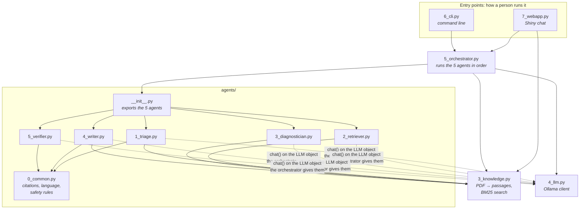

# How the Python files fit together

This page maps the code: which file uses which, what happens to one question, and what every
file is for. The arrows come from the real `import` statements in the code. For the design
reasons behind them, see [ARCHITECTURE.md](ARCHITECTURE.md).

The files are numbered in the order they come into use, so a file only uses files with a lower
number: `1_config` → `2_schemas` → `3_knowledge` → `4_llm` → `agents/` → `5_orchestrator` →
`6_cli`, `7_webapp`. Inside `agents/`, `0_common` comes before the five agents. In the code they
are imported without the number (`from pool_assistant import config`); the rule that makes this
work is in [`__init__.py`](../pool_assistant/__init__.py).

## 1. Which file uses which

An arrow `A → B` means *A uses B*. The layers read top to bottom: the entry points start
everything, the orchestrator runs the agents, and the agents use the knowledge base.

Not drawn, to keep the graph readable: **almost every file imports `1_config.py`** (paths,
models, modes, limits) **and `2_schemas.py`** (the data types passed between them). Neither
imports anything else from the project, so they sit underneath everything.

The dotted arrows: the agents never import `4_llm.py`. The orchestrator creates one `OllamaLLM`
and hands it to each agent that should use it. An agent given `None` uses its offline rules
instead. That is how one set of agents makes all six modes.

## 2. What happens to one question

The same flow runs whether the question comes from the web app, the CLI or the evaluation.
The names on the arrows are the types from `2_schemas.py`.

Which agents call the LLM depends on the mode:

| Mode | 1 triage | 2 retriever | 3 diagnostician | 4 writer | 5 verifier |
|---|---|---|---|---|---|
| `qwen`, `llama`, `gemma`, `deepseek` | LLM | LLM | LLM | LLM | LLM |
| `auto` | LLM | rules | rules | LLM | rules |
| `offline` | rules | rules | rules | rules | rules |

## 3. What every file is for

**The app** (`pool_assistant/`)

| File | What it does | Used by |
|---|---|---|
| [\_\_init\_\_.py](../pool_assistant/__init__.py) | Lets every numbered file be imported by its name without the number | Python, on every import |
| [1_config.py](../pool_assistant/1_config.py) | Paths (the manual, its English pages), the Ollama models, the six modes, limits | almost everything |
| [2_schemas.py](../pool_assistant/2_schemas.py) | The data types passed between files (Pydantic) | almost everything |
| [3_knowledge.py](../pool_assistant/3_knowledge.py) | Splits the PDF into page-sized passages and saves the index; loads it with the troubleshooting table; BM25 word search | orchestrator, webapp, agents. Run on its own (`python -m pool_assistant.knowledge`), it rebuilds the index |
| [4_llm.py](../pool_assistant/4_llm.py) | Sends prompts to Ollama, checks the JSON replies, reports failures as `LLMError` | orchestrator (creates it), agents (call it), entry points (catch its errors) |
| [5_orchestrator.py](../pool_assistant/5_orchestrator.py) | Builds the agents for a mode and runs them in order for each question | webapp, cli, evaluation/run |
| [agents/\_\_init\_\_.py](../pool_assistant/agents/__init__.py) | Exports the five agent classes | orchestrator |
| [agents/0_common.py](../pool_assistant/agents/0_common.py) | Shared rules: citations, language, symptom keywords, safety words and text | triage, writer, verifier, evaluation/report |
| [agents/1_triage.py](../pool_assistant/agents/1_triage.py) | Scope, intent, language, product, symptoms | orchestrator |
| [agents/2_retriever.py](../pool_assistant/agents/2_retriever.py) | Finds the manual passages to answer from | orchestrator |
| [agents/3_diagnostician.py](../pool_assistant/agents/3_diagnostician.py) | Ranks causes from the troubleshooting table | orchestrator |
| [agents/4_writer.py](../pool_assistant/agents/4_writer.py) | Writes the answer with citations and the safety warning | orchestrator |
| [agents/5_verifier.py](../pool_assistant/agents/5_verifier.py) | Checks citations and the safety warning (and grounding, in LLM modes) | orchestrator |
| [6_cli.py](../pool_assistant/6_cli.py) | `pool-assistant "question" --mode ...` | you |
| [7_webapp.py](../pool_assistant/7_webapp.py) | `pool-assistant-web`: the Shiny chat | you |

**Evaluation**

| File | What it does |
|---|---|
| [evaluation/run.py](../evaluation/run.py) | Asks the 10 questions in every mode and saves the answers and times |
| [evaluation/report.py](../evaluation/report.py) | Scores the saved answers and writes `REPORT.md` |

**Tests** (`tests/`, run with `pytest`, no Ollama needed)

| File | What it checks |
|---|---|
| [conftest.py](../tests/conftest.py) | Shared setup: the knowledge base, an offline assistant, a fake LLM |
| [test_knowledge.py](../tests/test_knowledge.py) | PDF splitting, search, symptom and language helpers |
| [test_orchestrator.py](../tests/test_orchestrator.py) | Whole questions in offline mode |
| [test_llm_agents.py](../tests/test_llm_agents.py) | Each agent's LLM mode, `auto` mode and mode selection, with a fake LLM |
| [test_webapp.py](../tests/test_webapp.py) | The web app's answering and formatting code |
